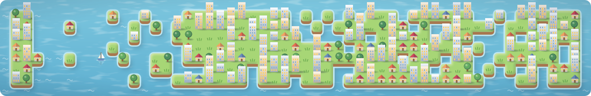
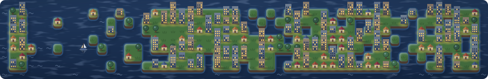

# Contribution-Village

Turns a GitHub contribution graph into a little village. When GitHub is in dark mode, it's night in the village.





| Contributions in a day | Tile |
| --- | --- |
| 0 | Water (sometimes a boat, if the tiles on all four sides are water too) |
| 1 | Grass |
| 2 | Tree |
| 3-5 | House |
| 6+ | Building (taller on busier days) |

## Put it on your profile

Add this workflow to your profile repository (the one named after your username) as `.github/workflows/village.yml`. It rebuilds the village every day and commits it.

```yaml
name: Village

on:
  schedule:
    - cron: '17 0 * * *'
  workflow_dispatch:

permissions:
  contents: write

jobs:
  village:
    runs-on: ubuntu-latest
    steps:
      - uses: actions/checkout@v7
      - uses: FrancisTRdev/Contribution-Village@V1
      - run: |
          git config user.name 'github-actions[bot]'
          git config user.email '41898282+github-actions[bot]@users.noreply.github.com'
          git add village.svg village-dark.svg
          git diff --cached --quiet && exit 0
          git commit -m 'Update village'
          git push
```

Run it once from the **Actions** tab, then add the image to your profile README. Visitors using GitHub in dark mode see the night version.

```html
<picture>
  <source media="(prefers-color-scheme: dark)" srcset="village-dark.svg" />
  
</picture>
```

### Inputs

| Input | Default | Description |
| --- | --- | --- |
| `username` | Repository owner | GitHub user whose contribution graph becomes the village. |
| `path` | `village.svg` | Where to write the SVG. The night version goes next to it, with `-dark` added to the name. Missing folders are created. |
| `token` | The workflow's token | Used to read the graph from the GitHub GraphQL API. You don't need to set it. |

## Run it locally

Needs Node.js 18 or newer. There are no dependencies.

```sh
node village.js <github-username> [output.svg]
```

This writes `village.svg` and the night version, `village-dark.svg`. Without a token it reads your public contributions page, so there's nothing to set up. To read from the GitHub API like the Action does, set `GITHUB_TOKEN` to a personal access token first.

To try it out without anyone's data, use `--random` instead of a username. It makes up a contribution graph, so each run gives a different village.

```sh
node village.js --random [output.svg]
```
